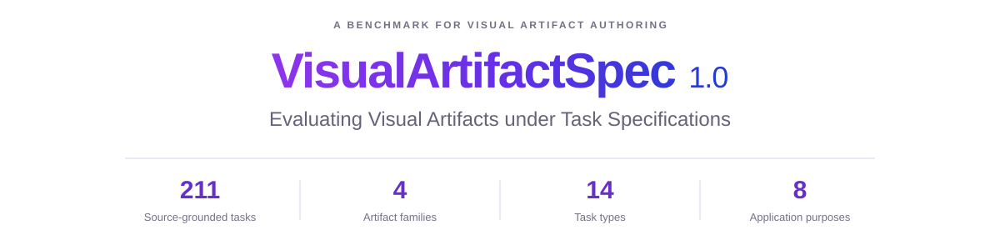
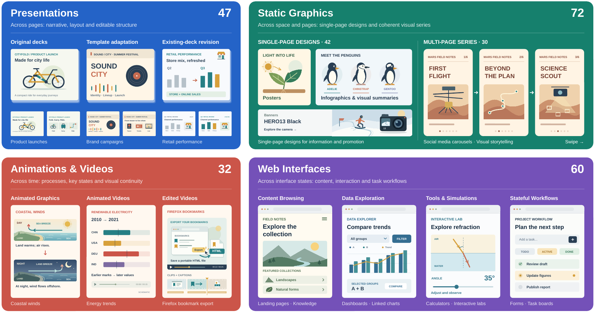
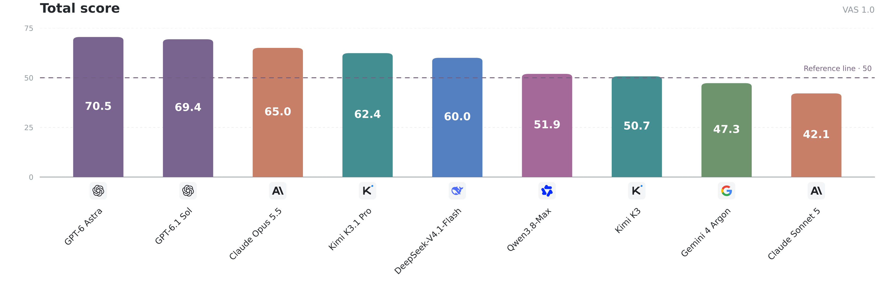
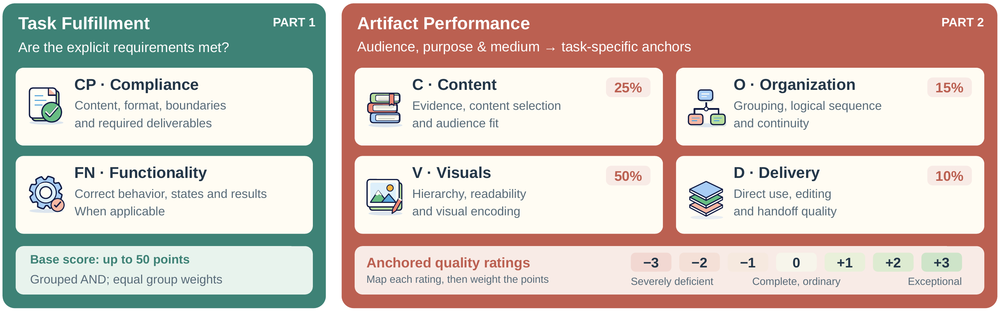
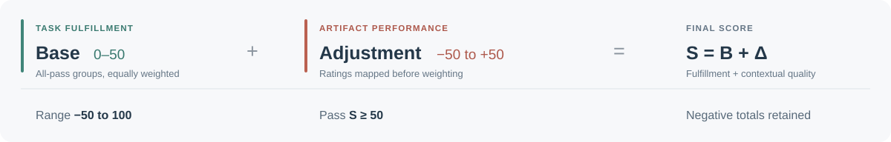

<p align="center">
  
</p>

<p align="center">
  <a href="https://accio-lab.github.io/VisualArtifactSpec/"></a>
  &nbsp;
  <a href="https://huggingface.co/datasets/Accio-Lab/VisualArtifactSpec"></a>
  &nbsp;
  
</p>

<p align="center">
  <a href="#benchmark">Benchmark</a> &nbsp;·&nbsp;
  <a href="#results">Results</a> &nbsp;·&nbsp;
  <a href="#evaluation">Evaluation</a> &nbsp;·&nbsp;
  <a href="#quick-start">Quick Start</a> &nbsp;·&nbsp;
  <a href="src/vas_bench/judge_protocol.md">Judge Protocol</a>
</p>

**VisualArtifactSpec 1.0 (VAS)** is a benchmark of 211 source-grounded creation and modification tasks across presentations, static graphics, animations and videos, and web interfaces. Each task specifies authoring objectives, materials, constraints, and deliverables.

VAS separates **Task Fulfillment** from **Artifact Performance**: whether an artifact meets its specified obligations, and how well its content, organization, visuals, and delivery serve the intended audience, purpose, and medium. Task-specific criteria and inspectable evidence support traceable diagnosis across artifact families.

<p align="center">
  
  <br><sub>Four artifact families, from slide narratives to stateful web workflows. Illustrations are not model results.</sub>
</p>

## Benchmark

| Artifact family | Tasks | Task forms |
| --- | ---: | --- |
| **Presentations** | 47 | Original decks, template adaptation, existing-deck revision |
| **Static Graphics** | 72 | Posters, infographics, banners, multi-page series |
| **Animations & Videos** | 32 | Animated graphics, animated videos, edited videos |
| **Web Interfaces** | 60 | Content browsing, data exploration, tools and simulations, stateful workflows |

Tasks include creation, adaptation, revision, repair, and conversion. Categories follow the primary authoring objective, rather than the file extension: HTML may encode slides, an animation, or a website.

All prompts, platform requirements, rubrics, and attachments live in the [Hugging Face dataset](https://huggingface.co/datasets/Accio-Lab/VisualArtifactSpec). This repository provides the **local Docker Judge and scoring tools**. Supply artifacts generated by your own agent.

## Results



Overall scores on VisualArtifactSpec 1.0. Higher is better. Each task combines a Task Fulfillment base score with an Artifact Performance adjustment; see [Evaluation](#evaluation) for the scoring protocol.

## Evaluation

Two complementary assessments distinguish requirement satisfaction from the quality and contextual suitability of authoring choices.

<p align="center">
  
</p>

<p>
  
</p>

The base score reflects the fraction of acceptance groups passed; every requirement in a group must pass. The adjustment rewards or penalizes artifact quality using 18 shared criteria with task-specific anchors across Content, Organization, Visuals, and Delivery.

Every judgment links to retained evidence. Unresolved evaluations remain **unscored**. [Read the Judge protocol →](src/vas_bench/judge_protocol.md)

<details>
<summary>Scoring and reporting details</summary>

Task Fulfillment checks Compliance (CP) and applicable Functionality (FN). Artifact Performance uses 18 shared criteria with task-specific anchors informed by audience, purpose, and medium. Evidence includes source materials, rendered views, native structures, temporal observations, and recorded interactions as appropriate.

For a fraction F of passed acceptance groups, the base score is B = 50F. CP and applicable FN share this allocation. Each group receives the same weight regardless of its child count or item weights; one or more No judgments forfeit that group's allocation.

Map **each criterion rating before averaging**:

| Rating | −3 | −2 | −1 | 0 | +1 | +2 | +3 |
| --- | ---: | ---: | ---: | ---: | ---: | ---: | ---: |
| Points | −50 | −25 | −10 | 0 | +10 | +25 | +50 |

Within each performance dimension, average mapped points using the criterion weights. For dimension point scores pC, pO, pV, and pD:

```text
Δ = 0.25 pC + 0.15 pO + 0.50 pV + 0.10 pD
S = 50F + Δ
```

The mapping is nonlinear; averaging raw ratings before mapping gives a different result. `normalized_100` is a diagnostic display of mapped points + 50, not the final task score. Totals are not clipped.

Report the base, dimension point scores, adjustment, and total separately, along with equal-task means over valid scores, family means and counts, and expected/completed/failed/missing counts. Compare common valid tasks under matching rubrics and protocols. Record the data revision, task selection, model and reasoning settings, Judge configuration, tools, and budgets.

</details>

## Quick start

### 1. Install and download

Requires **Python 3.11+** and a running **Docker** daemon. The host package uses only Python's standard library; the Hugging Face CLI is needed for downloading data.

```bash
pip install -e .
docker build -t vas-judge:local -f sandbox/Dockerfile .

pip install huggingface_hub
hf download Accio-Lab/VisualArtifactSpec \
  --repo-type dataset \
  --revision 077605d4420ac04af081746a5018dc3644319301 \
  --local-dir .cache/dataset
vas-bench validate --data .cache/dataset/data
```

Authenticate with `hf auth login` if dataset access requires it. Download includes inputs; the Judge verifies attachment hashes before evaluation.

<details>
<summary>Dataset files and reproducibility</summary>

Each `data/tasks/TASK_ID/` contains `prompt.md`, `platform_instructions.txt`, `task.json`, `rubric.json`, `inputs.manifest.json`, and any `inputs/`. Task metadata records acceptance-group membership and objective definitions; rubrics specify criteria, answer anchors, and weights.

Pinned catalog SHA-256 (`data/benchmark.json`): `2076eed3fae9e0194579b8c82abffb9ace39a9e24685017c9a1f1b3d25232cc2`.

The dataset contains **211 tasks and 3,125 acceptance groups**. Each group represents one independently acceptable output or behavior, including its required normal, boundary, and failure-recovery checks. Groups remain within CP or FN and share the same 50-point pool; neither a fixed group count nor a fixed CP/FN ratio is imposed. See the [dataset card](https://huggingface.co/datasets/Accio-Lab/VisualArtifactSpec/blob/077605d4420ac04af081746a5018dc3644319301/README.md) for task coverage and file formats.

Active scoring version: `unified-211-signed-50-50-group-all-pass-nonlinear-v3` (package 0.4.1). The pinned dataset uses the same scoring version. The validator checks task-file hashes, rubric groups, and metadata. Fix dataset and scoring versions before comparing systems.

</details>

### 2. Configure and evaluate

Place deliverables in `submissions/TASK_ID/artifact/`, using dataset IDs such as `presentations-001` or `web-interfaces-001`. Submit regular files and directories; symlinks are not supported.

Use a vision-capable model on a Responses-compatible endpoint supporting function calls, image tool outputs, and stateless reasoning continuation:

```bash
export JUDGE_API_KEY="YOUR_API_KEY"
export JUDGE_BASE_URL="https://api.openai.com/v1"
export JUDGE_MODEL="gpt-6-astra"
export JUDGE_REASONING_EFFORT="medium"

vas-bench judge \
  --data .cache/dataset/data \
  --artifacts submissions --output results --workers 6
```

The Judge uses the formal evaluation protocol: Web Interfaces are inspected at 1440×900 and 390×844, while other artifacts use medium-appropriate rendering, structure, timing, and interaction checks. Each quality item follows its own anchors, checking negative impacts first and then the highest consecutively satisfied positive level. The selected protocol is fingerprinted for resume checks; results from earlier protocols require a fresh output directory.

The Judge inspects artifacts through shell and image tools, retains evidence, writes per-item judgments, and calls `finish`. The harness validates coverage, computes scores, and rechecks evidence integrity after stopping the container. Results and failures appear in `results/summary.json`.

<details>
<summary>Single-task runs, Azure, budgets, and resume</summary>

Append `--task web-interfaces-001 --workers 1` for one case; repeat `--task` for a subset. Default selection is the full catalog. `vas-bench judge --help` lists all options.

| Option | Default / behavior |
| --- | --- |
| `--workers N` | 6 concurrent cases |
| `--resume` | Reuse completed cases with matching sources, settings, protocol, and evidence |
| `--network bridge` | Enable container network access; default `none` |
| `--timeout SECONDS` | 3600 seconds of agent time per case |
| `--max-turns N` | 100 model turns per case |
| `--command-timeout SECONDS` | 120 seconds per shell command |
| `--api-timeout SECONDS` | 300 seconds per API request |

For Azure v1, set `JUDGE_BASE_URL=https://YOUR_RESOURCE.openai.azure.com/openai/v1`, `JUDGE_API_KEY_HEADER=api-key`, and `JUDGE_MODEL` to your deployment name. Legacy Azure endpoints requiring an `api-version` query are not supported. Credentials stay on the host.

Each disposable container gets 2 CPUs and 4 GiB RAM; six cases can require up to 24 GiB. Reduce concurrency for smaller machines. Inputs and artifacts are staged read-only, while working copies and evidence are writable. The image includes Chromium/Playwright, LibreOffice, PDF tools, ffmpeg, Python, and Node/npm. Enable networking when dependencies or external assets require it, and report that choice. Requirements needing unavailable desktop software require another suitable environment.

Failed or changed cases require a fresh output directory. Concurrent controllers must use separate output directories. Missing submissions and failed evaluations are reported separately and cause a nonzero exit status. Evidence checks establish retention and attribution, not the truth of observations.

</details>

<details>
<summary>Output files</summary>

```text
results/TASK_ID/
  evaluation/result.json     Per-item judgments
  evaluation/evidence.json   Evidence index
  evaluation/               Evidence, screenshots, logs, and working copies
  score.json                Validated score
  run.json                  Settings, fingerprints, image ID, and status
  trace/                    Tool trace and evidence integrity receipt
  workspace/                Staged task and artifact
```

</details>

### 3. Rescore existing judgments

Revalidate evidence and recompute available cases without calling a model:

```bash
vas-bench score-all \
  --data .cache/dataset/data --results results --output results/summary.json
```

Existing −3…+3 Judge answers can be rescored directly with v3; no new judgments are required. Scoring commands replace derived score files, so keep a copy of historical results before reaggregation. Outputs record the active scoring version and exact quality mapping; summaries also identify the scoring version. Compare results only under the same scoring version.

<details>
<summary>Single-case scoring and result format</summary>

```bash
vas-bench score \
  --rubric .cache/dataset/data/tasks/TASK_ID/rubric.json \
  --judgments results/TASK_ID/evaluation/result.json \
  --evidence-root results/TASK_ID \
  --output results/TASK_ID/score.json
```

Omitting `--evidence-root` performs arithmetic only. Results must cover every rubric ID exactly once. Binary answers are `Yes`/`No`; quality answers are strings from `-3` to `3`, chosen from the item's answer anchors. This example shows one item:

```json
{"results":[{"id":"ACTUAL_RUBRIC_ID","answer":"Yes","reason":"Observed behavior: evaluation/evidence/check.txt"}]}
```

Each item must cite an indexed, nonempty evidence file under `evaluation/evidence/`, `evaluation/screenshots/`, or `evaluation/logs/`:

```json
{"observations":[{"ids":["ACTUAL_RUBRIC_ID"],"files":["evaluation/evidence/check.txt"],"note":"Observed page, state, timestamp, or interaction."}]}
```

</details>

<details>
<summary>Run tests</summary>

```bash
python -m unittest discover -s tests -v
VAS_TEST_DOCKER=1 python -m unittest discover -s tests -p test_docker_integration.py -v
```

Docker integration uses a mock model API and does not incur model charges.

</details>

## License

Code, tests, and the Judge harness use [Apache-2.0](https://www.apache.org/licenses/LICENSE-2.0); original task instructions, rubrics, evaluation protocols, test fixtures, and illustrations use [CC BY 4.0](https://creativecommons.org/licenses/by/4.0/); third-party attachments and components retain their original licenses and attribution requirements.
